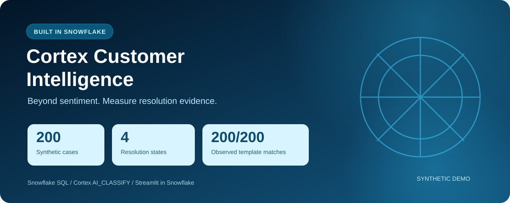
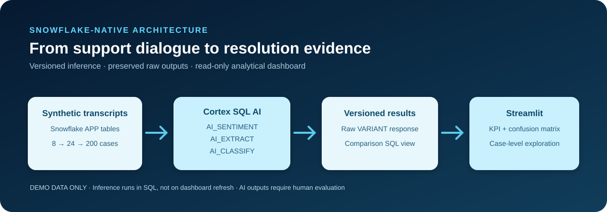
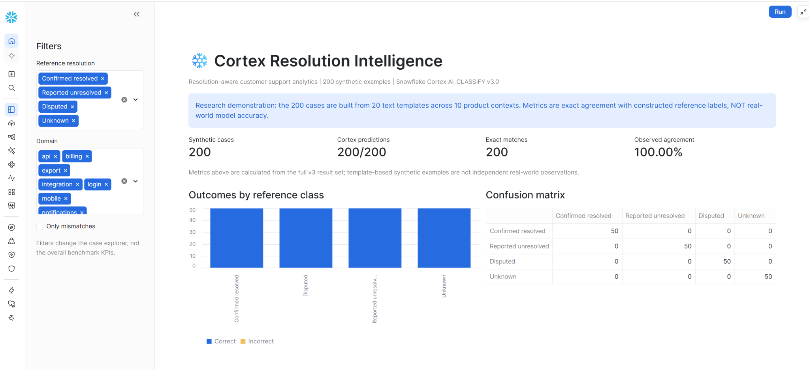
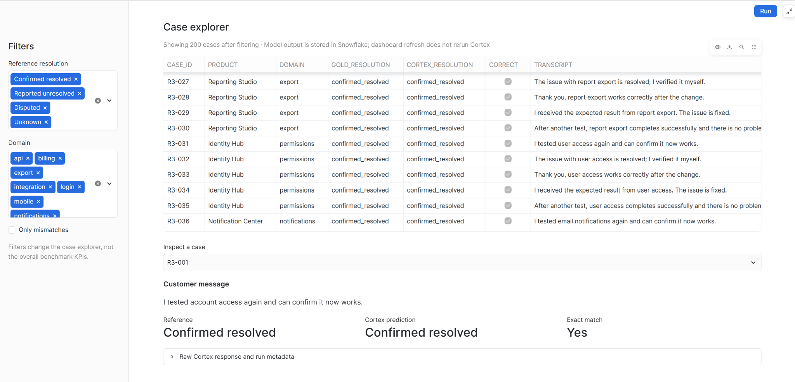

<div align="center">

# ❄️ Snowflake Cortex Customer Intelligence
### Beyond sentiment. Understand whether the customer's issue is actually resolved.

**Snowflake-native SQL + Cortex AI + Streamlit in Snowflake**

[](https://www.snowflake.com/)
[](https://docs.snowflake.com/en/user-guide/snowflake-cortex/overview)
[](https://docs.snowflake.com/en/developer-guide/streamlit/about-streamlit)
[](LICENSE)
[](https://doi.org/10.5281/zenodo.24098765)

An open-source reference implementation that classifies **resolution evidence** in support messages using **Snowflake Cortex `AI_CLASSIFY`** and explores the stored outputs in **Streamlit in Snowflake**.

[Explore the 200-case results](data/resolution_v3_observed.csv) · [Run the complete SQL](sql/09_resolution_v3_200_benchmark.sql) · [Open the dashboard source](streamlit_resolution_v3.py) · [Read the technical article](docs/article-beyond-sentiment.md) · [Zenodo DOI](https://doi.org/10.5281/zenodo.24098765)

</div>



---

## 90-second implementation presentation

[▶ **Watch the 90-second Snowflake Cortex implementation presentation**](Snowflake_Cortex_90s_Presentation_NEW.mp4)

A concise, **silent, presentation-style** walkthrough of the Snowflake-native architecture, Cortex classification, stored predictions, evaluation, and real Streamlit dashboard. The video contains no narration or background music.

## The problem: polite ≠ resolved

> **“Thanks for the update. I appreciate your efforts, but my account is still locked.”**

Sentiment may be **neutral**; the issue is still unresolved. A customer can also dispute a ticket being marked resolved. Treating all those situations as simple positive or negative sentiment hides useful operational evidence.

This project separates three concepts that are easy to conflate:

| Dimension | What it tells you |
|---|---|
| **Sentiment polarity** | Positive, negative, neutral or other polarity captured from text |
| **Expressed dissatisfaction** | Whether the customer expresses a complaint or dissatisfaction |
| **Resolution evidence** | Whether the customer verifies a fix, reports continued failure, disputes a claimed fix, or provides insufficient evidence |

**This repository's 200-case benchmark evaluates only the third concept: resolution evidence.** It does not measure dissatisfaction-classifier accuracy.

## Snowflake architecture



Everything in the demonstrated inference and reporting pipeline ran **inside Snowflake**: SQL tables, `AI_CLASSIFY` inference, raw `VARIANT` response storage, views, and Streamlit in Snowflake. The app reads stored predictions, so **refreshing the dashboard does not rerun AI functions**.

### The four resolution-evidence states

| Label | Meaning | Typical evidence |
|---|---|---|
| `confirmed_resolved` | Customer confirms the solution works | “I tested it and the issue is fixed.” |
| `reported_unresolved` | Problem persists; no explicit contradiction of a claimed completed fix | “It still fails after troubleshooting.” |
| `disputed` | Customer contradicts a previous assertion of successful resolution | “The ticket says resolved, but the problem is still there.” |
| `unknown` | No reliable current resolution evidence | “Please send the documentation.” |

## Observed Snowflake trial results

The project owner executed the pipeline in a **Snowflake trial account (November 2026)** and shared raw SQL results and screenshots of the running Streamlit dashboard.

| Experiment | Task | Results | Why it matters |
|---|---|---|---|
| **8-case smoke test** | `AI_SENTIMENT`, `AI_EXTRACT`, `AI_CLASSIFY` | 8/8 enriched; sentiment reference agreement **6/8**; issue reference agreement **5/8** | Verifies the end-to-end ingestion and inference path |
| **Resolution v2 · 24 cases** | Initial four-way `AI_CLASSIFY` | **20/24 (83.33%)** exact matches | Reveals ambiguity between reported unresolved and disputed states |
| **Resolution v3 · 200 cases** | Refined four-way `AI_CLASSIFY` | **200/200 (100%)** exact matches | Confirms expected outcomes on a controlled synthetic template set |

> [!IMPORTANT]
> **The v3 result is not 100% real-world accuracy.** The 200 synthetic examples come from **20 authored sentence patterns across 10 product/feature contexts**. These are highly correlated examples with constructed reference labels, not 200 independently annotated real-world conversations. The v2 and v3 prompts **and datasets** differ, so the observed percentages cannot isolate a prompt improvement. Results have not been independently replicated in another Snowflake account.

**Evidence:** [Complete 200-row observed Cortex predictions](data/resolution_v3_observed.csv) · [24-case observed predictions](data/resolution_v2_observed.csv) · [8-case results](data/cortex_smoke_observed.csv) · [Detailed results/limitations](docs/resolution-v3-observed-results.md)

## Streamlit in Snowflake dashboard

The live v3 dashboard shows **200 synthetic cases, 200 stored predictions, a per-class outcome chart, a four-category confusion matrix, and a searchable case-level explorer**. The images used for the demonstration come from the actual Snowsight session—not a generated mockup.

**Dashboard Python source:** [`streamlit_resolution_v3.py`](streamlit_resolution_v3.py)

**Actual Snowsight screenshots:** These are captures of the live **200-case v3** Streamlit in Snowflake dashboard, now committed under [`docs/images/`](docs/images/). They show the running analytical dashboard and its case-level explorer.

### 200-case dashboard overview



*Figure 1. Streamlit running in Snowflake with 200 synthetic cases, per-class outcomes, and a four-state confusion matrix. The observed 200/200 reference-label agreement is on templated synthetic examples, not production accuracy.*

### Case-level exploration



*Figure 2. The actual Streamlit case explorer with product and domain filters, customer messages, raw stored model responses, reference labels, and Cortex predictions.*

## Run it yourself in Snowflake

The smallest path to reproduce the v3 resolution experiment:

1. Use an authorized Snowflake account with **Cortex AI_CLASSIFY** access and a warehouse. The supplied script expects `CORTEX_CI_DEMO`, `APP`, and `CORTEX_CI_WH` to exist.
2. Open [**`sql/09_resolution_v3_200_benchmark.sql`**](sql/09_resolution_v3_200_benchmark.sql) in Snowsight, review inference costs, and choose **Run All**. It creates the v3 tables, seeds 200 *synthetic* cases, runs the classification once per version+case, and creates `V_RESOLUTION_V3_COMPARISON`.
3. Create a **Streamlit in Snowflake** app using [`streamlit_resolution_v3.py`](streamlit_resolution_v3.py), with read access to `CORTEX_CI_DEMO.APP.V_RESOLUTION_V3_COMPARISON`.
4. Use the resulting dashboard to explore stored predictions; refreshing it does not trigger more Cortex inference.

For the broader sentiment/entity/issue pipeline, start with [`docs/deployment-validation.md`](docs/deployment-validation.md). Snowflake Cortex calls may incur usage charges; API availability and role permissions depend on your account.

### Explore the results without a Snowflake account

The exact observed 200-row output is already available as a [downloadable CSV in this repository](data/resolution_v3_observed.csv). You can reproduce the exported metrics offline:

```python
import csv
from collections import Counter

with open("data/resolution_v3_observed.csv", newline="", encoding="utf-8") as f:
    rows = list(csv.DictReader(f))

print("Cases:", len(rows))
print("Predictions:", sum(bool(r["CORTEX_RESOLUTION"]) for r in rows))
print("Exact matches:", sum(r["GOLD_RESOLUTION"] == r["CORTEX_RESOLUTION"] for r in rows))
print("Class balance:", Counter(r["GOLD_RESOLUTION"] for r in rows))
```

More details: [Reproducibility and results](docs/reproducibility-and-results.md).

## Repository contents

| Path | Purpose |
|---|---|
| [`sql/09_resolution_v3_200_benchmark.sql`](sql/09_resolution_v3_200_benchmark.sql) | One-file v3 SQL: seed, classify, compare, export |
| [`streamlit_resolution_v3.py`](streamlit_resolution_v3.py) | Live Streamlit 200-case dashboard |
| [`data/resolution_v3_observed.csv`](data/resolution_v3_observed.csv) | **Actual observed** 200-case Cortex predictions |
| [`docs/resolution-v3-observed-results.md`](docs/resolution-v3-observed-results.md) | Results, confusion matrix, limitations |
| [`docs/article-beyond-sentiment.md`](docs/article-beyond-sentiment.md) | Community-ready technical article draft |
| [`streamlit_app.py`](streamlit_app.py) and [`sql/00_setup.sql`](sql/00_setup.sql) | Original sentiment/entity/issue enrichment demo |
| [`docs/architecture.md`](docs/architecture.md) | Data flow and design principles |
| [`docs/security.md`](docs/security.md) | Responsible-use and data protection checklist |

## Security, scope, and attribution

- **Synthetic data only.** No real customer or employer support transcripts are included.
- For a real deployment: authorization, PII redaction, access controls, retention, cost monitoring, and human review are essential.
- This is an **independent educational reference project**. It is not affiliated with or endorsed by Snowflake or Salesforce.
- The related [BIRD-inspired extension](docs/bird-extension.md) is a transparent illustrative rules baseline, **not** the trained BIRD-lite model from the separate research manuscript.
- MIT licensed. Contributions, reproducibility feedback, and carefully labeled synthetic challenge cases are welcome.

<sub>Observed live run: November 9, 2026 · Last refreshed for public documentation: November 2026</sub>
