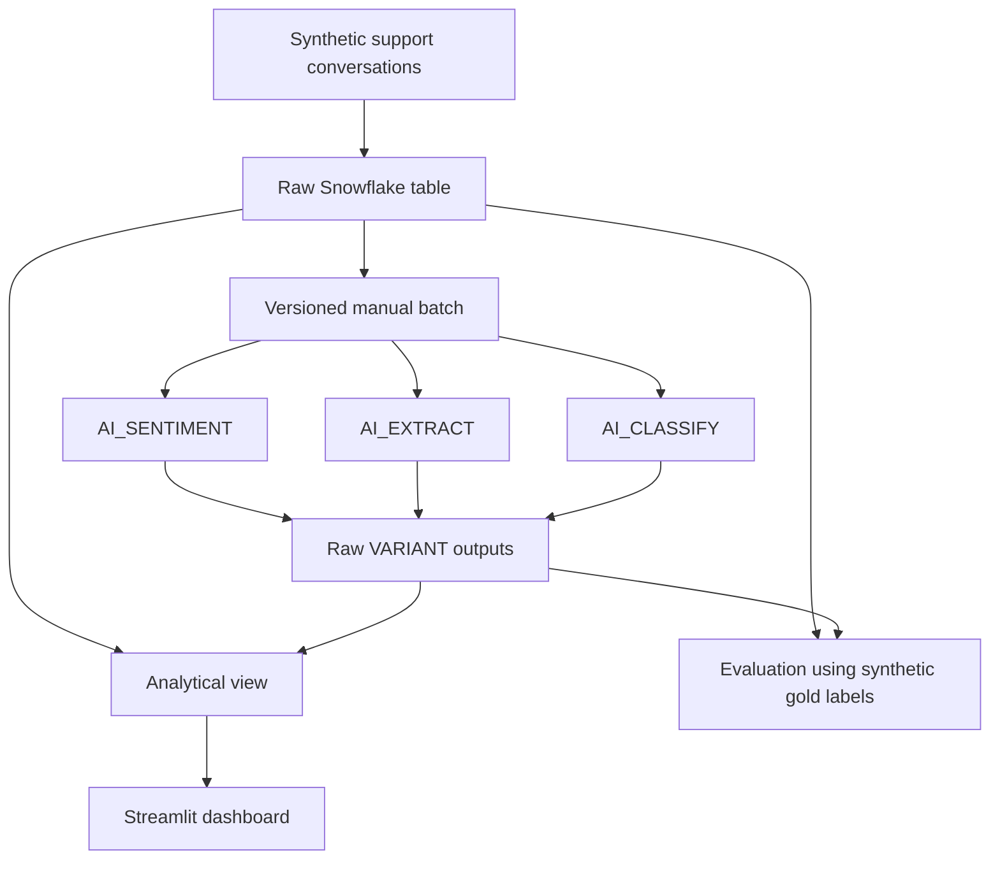

# Architecture

## Design principles

1. **Capped inference:** An explicit batch of 25 rows avoids triggering AI calls on dashboard refresh.
2. **Idempotent success guard:** Already-enriched conversation/version pairs are skipped; changing prompt or taxonomy should change the version.
3. **Auditability:** Keep raw variant outputs until response shapes have been validated in the executing account.
4. **Separation:** The dashboard reads a view and does not require AI inference privileges.
5. **Reproducibility:** Synthetic sample data and deterministic offline evaluation functions are included.
6. **Safety:** No actual support interactions, credentials, or proprietary implementations are present.

## Not production-ready
Before using real data, introduce pre-inference PII redaction, explicit authorizations, privacy review, record-level ACLs, model-output validation, audit logging, row access policies, retention/deletion handling, monitoring and incident response.
